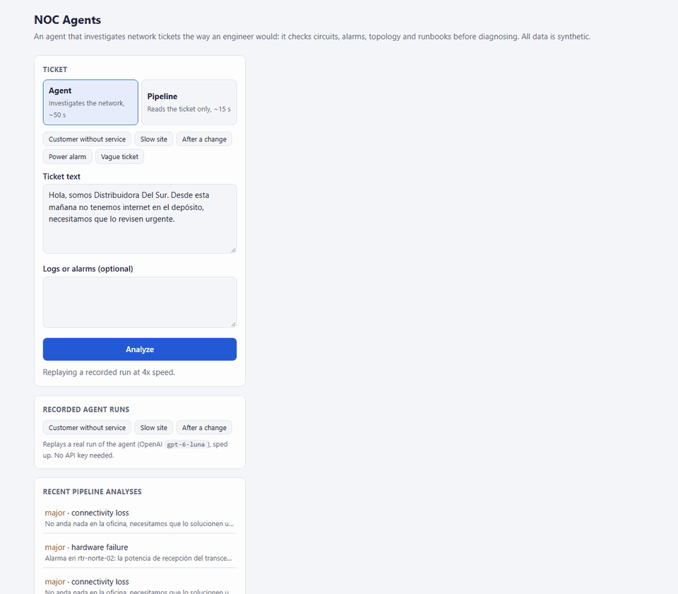
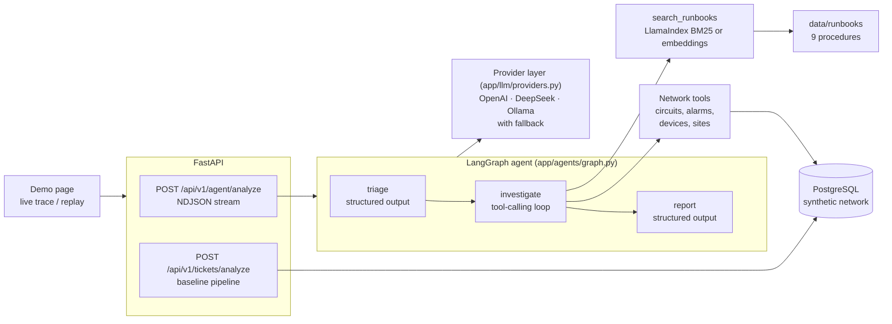

# NOC Agents

[](https://github.com/Antonella94duarte/noc-ticket-assistant/actions/workflows/ci.yml)

A proof of concept of AI agents for a Network Operations Center (NOC): an agent that reads an
incident ticket, **investigates the network the way an engineer would** (circuits, alarms,
topology, internal runbooks) and writes a diagnosis grounded on what it found. It is compared,
with measurements, against a plain LLM pipeline, across three model providers and two agent
frameworks.



*A recorded run, replayed at 4x. All tickets, customers, sites and devices are synthetic. The
finished analysis, with causes, steps and cited runbook: [screenshot](docs/screenshots/agent-analysis.png).*

## In one minute

**The problem.** A customer writes "we have no internet at the warehouse since this morning". To
answer, a NOC engineer looks up which circuit is theirs, which device and port serve it, what
alarms are active there, and what the procedure says. A model that only reads the ticket can't do
any of that: it can only guess.

**What the agent does.**

1. **Triage**: classifies the ticket (category, severity, entities, open questions).
2. **Investigate**: decides which lookups to make and makes them: finds the customer's circuit,
   checks the alarms on its port and site, the device's redundancy, and searches the runbooks.
3. **Report**: probable causes with their evidence, diagnostic steps with CLI commands citing the
   runbook ("[RB-008]"), recommended actions, a customer reply draft, and the severity revised
   with what it found.

**Does it work?** On 30 labeled synthetic tickets, with OpenAI `gpt-6-luna`:

| | Root cause found | Final severity right | Time | Cost per ticket |
|---|---|---|---|---|
| Pipeline (reads the ticket only) | 1 of 23 | 23 of 30 | 17 s | $0.0013 |
| **Agent** (investigates) | **21 of 23** | 26 of 30 | 46 s | $0.0029 |
| Agent + runbook search | 20 of 23 | **27 of 30** | 58 s | $0.0036 |

Investigating is what finds the cause, for about a third of a cent per ticket. DeepSeek reaches
the same accuracy (20/23); a 4B model running locally finds the evidence but misjudges severity.
The same agent built with CrewAI gives the same quality at about 3x the cost, and small Hugging
Face models can't replace the LLM for triage, though a 118M one handles runbook search. The agent's main
weakness: sometimes it blames the loudest alarm nearby instead of the customer's own port.

## Try it

Requires Docker. Where to get the API keys, and how to run a free local model with Ollama:
[docs/providers-setup.md](docs/providers-setup.md).

```bash
cp .env.example .env          # then set OPENAI_API_KEY (or another provider, see below)
docker compose up --build
```

- Demo page: http://localhost:8000. **Recorded agent runs** replay without any API key; with a
  key, pick a scenario and press Analyze to watch the agent live.
- Interactive API docs: http://localhost:8000/docs

The container applies the database migrations and loads the synthetic network on start. Without a
key the API still starts and the analysis endpoints answer `503`.

From the command line:

```bash
python scripts/run_agent.py --scenario customer-no-service    # also slow-site, config-change, power-alarm, vague
```

## Architecture



- **The agent** is a LangGraph graph of three steps. Only the middle one is autonomous: a
  LangChain `create_agent` loop that chooses its own tool calls, with middleware capping tool and
  model calls (so a confused agent can't spend without limit) and falling back to another provider
  when one fails. Triage and report use structured output validated against Pydantic schemas.
- **Tools** are plain read-only functions over the database (`app/tools/network.py`), independent
  of any framework, returning compact results, capped lists and name suggestions when the model
  misspells a hostname. LangGraph and CrewAI wrap the same functions.
- **Runbook search** (`app/rag/runbooks.py`) indexes the procedures by section with LlamaIndex:
  BM25 by default (offline, free), or embeddings for multilingual queries: OpenAI, `bge-m3` through
  Ollama, or a Hugging Face model in the API process.
- **Providers** are chosen with `LLM_PROVIDER`, with `LLM_FALLBACK_PROVIDERS` tried in order. Each
  needs a different way to get structured output (strict JSON schema, JSON mode, function calling),
  handled in one place.
- **The stream**: `POST /api/v1/agent/analyze` sends one JSON event per line as each step
  finishes (`triage`, `tool_call`, `tool_result`, `findings`, `report`, `analysis`), which is what
  the demo page draws. `scripts/record_demo.py` saves those events for the replays.

## Results and comparisons

| Question | Answer | Write-up |
|---|---|---|
| Does investigating beat reading the ticket? | Root cause 21/23 vs 1/23; runbooks ground the steps (21/24 cite the right one) without raising accuracy | [model-comparison.md](docs/model-comparison.md) |
| OpenAI vs DeepSeek vs a local model? | OpenAI cheapest per ticket; DeepSeek as accurate but ~4x the cost here; `qwen3:4b` free and private, finds evidence, misjudges severity, ~2 min per ticket | [model-comparison.md](docs/model-comparison.md) |
| LangGraph or CrewAI? | Same quality; CrewAI makes ~21 model calls instead of ~6 (3x the cost) and its structured output fails on DeepSeek. LangGraph stays | [framework-comparison.md](docs/framework-comparison.md) |
| BM25 or embeddings for runbooks? | BM25 12/12 in English, 3/6 in Spanish; embeddings 18/18 | [ADR 0004](docs/decisions/0004-runbook-retrieval.md) |
| Can small Hugging Face models replace the LLM? | Not for triage: zero-shot gets 30/53 categories, barely above always answering the most common one (27/53), vs 53/53 for the LLM. Yes for runbook search: a 118M embedding model on a CPU gets 18/18 | [small-models-comparison.md](docs/small-models-comparison.md) |

Everything is reproducible with the scripts in `scripts/` (`evaluate_agents.py`,
`evaluate_retrieval.py`, `evaluate_small_models.py`, `evaluate.py`); raw results, including every diagnosis, are in
`data/eval/results/`.

## Design decisions

| ADR | Decision |
|---|---|
| [0001](docs/decisions/0001-evolve-into-agents.md) | Evolve the ticket assistant into agents, keeping the pipeline as the baseline |
| [0002](docs/decisions/0002-provider-agnostic-llm-layer.md) | A provider-agnostic model layer (OpenAI, DeepSeek, Ollama) with fallback |
| [0003](docs/decisions/0003-langgraph-investigation-agent.md) | A three-step LangGraph graph with one tool-using investigator |
| [0004](docs/decisions/0004-runbook-retrieval.md) | Runbook retrieval by section, BM25 by default |
| [0005](docs/decisions/0005-langgraph-over-crewai.md) | Keep LangGraph; CrewAI as a documented comparison |
| [0006](docs/decisions/0006-small-models.md) | Keep the LLM for triage; allow a local Hugging Face model for runbook search |

## API

| Method | Path | Description |
|---|---|---|
| `POST` | `/api/v1/agent/analyze` | Investigate a ticket with the agent; streams NDJSON events. Not stored |
| `POST` | `/api/v1/tickets/analyze` | Baseline pipeline; stored, and an identical ticket is answered from the database |
| `GET` | `/api/v1/tickets/{id}`, `/api/v1/tickets` | Stored pipeline analyses, with filters and pagination |
| `GET` | `/health` | API and database status |

```bash
curl -N -X POST http://localhost:8000/api/v1/agent/analyze \
  -H "Content-Type: application/json" \
  -d '{"ticket_text": "Hola, somos Distribuidora Del Sur. Desde esta mañana no tenemos internet en el depósito."}'
```

Abridged, from a recorded run (`app/static/demo/customer-no-service.ndjson`):

```
{"type": "start", "provider": "openai", "model": "gpt-6-luna", "prompt_version": "agent:classify_v3+investigate_v2+report_v3", "elapsed": 0.0}
{"type": "triage", "classification": {"category": "connectivity_loss", "severity": "major", ...}, "elapsed": 9.6}
{"type": "tool_call", "id": "call_…", "name": "find_circuits", "args": {"query": "Distribuidora Del Sur"}, "elapsed": 11.7}
{"type": "tool_result", "id": "call_…", "name": "find_circuits", "result": "{\"found\":true,\"circuits\":[{\"circuit_id\":\"SUR-2210\", ...", "elapsed": 11.8}
...
{"type": "findings", "text": "- Circuito: find_circuits encontró SUR-2210 ...", "elapsed": 25.3}
{"type": "report", "diagnosis": {"probable_causes": [...], "severity": "major", "severity_reason": "..."}, "elapsed": 48.8}
{"type": "analysis", "analysis": {"tool_calls": [...], "usage_by_model": {...}, ...}, "estimated_cost_usd": 0.0033, "elapsed": 48.8}
```

The pipeline endpoints, its prompt engineering, data model and prompt evaluation are described in
[docs/baseline-pipeline.md](docs/baseline-pipeline.md).

## Tech stack

| Area | Used for |
|---|---|
| Python 3.12, FastAPI, Pydantic v2 | API, streaming, schemas for every model output |
| LangGraph 1.2, LangChain 1.4 | Agent graph, tool-calling loop, call limits, provider fallback |
| LlamaIndex 0.14 | Runbook indexing and retrieval (BM25, embeddings) |
| CrewAI 1.15 | Framework comparison, in its own image (`requirements-crewai.txt`) |
| Hugging Face Hub, transformers, sentence-transformers | Model search through the Hub API, zero-shot triage and local embeddings, in their own image (`requirements-hf.txt`) |
| OpenAI, DeepSeek, Ollama | Model providers (`gpt-6-luna`, `deepseek-flash`, `qwen3:4b`, `bge-m3`) |
| PostgreSQL 16, SQLAlchemy 2, Alembic | Network data, stored analyses (JSONB), migrations |
| pytest, ruff, GitHub Actions, Docker Compose | Tests against a real database, lint, CI, local stack |

## Security and privacy

- **Synthetic data only.** Sending real tickets to an external provider sends customer data to
  it; for real use, prefer a local model (Ollama: nothing leaves the machine) or check the
  provider's data terms.
- **Prompt injection**: tickets and logs are delimited and their tags neutralized, prompts declare
  them as data, and the eval set includes injections in the ticket and in the logs.
- **The agent is read-only**: its tools only query; it can't change the network. Tool and model
  calls are capped per run.
- **Untrusted output in the UI**: ticket text, tool results and model output are inserted with
  `textContent`, never as HTML.
- **Errors**: provider error details are logged, not returned to clients.
- **Secrets**: keys are read from the environment as `SecretStr`; `.env` is git-ignored. CrewAI's
  telemetry is turned off in code.

## Testing and CI

```bash
pytest
ruff check . && ruff format --check .
```

- No test calls a real model: the agent graph runs end to end with scripted fake models and the
  real tools over a test PostgreSQL database (rolled back after each test).
- Real-model checks run by hand: `scripts/check_providers.py` (tool calling and structured output
  per provider) and the evaluation scripts.
- GitHub Actions runs lint, the test suite against a PostgreSQL 16 service, and the CrewAI tests in
  their own job.

## Configuration

The main variables; every one is documented in [.env.example](.env.example).

| Variable | Default | Description |
|---|---|---|
| `LLM_PROVIDER` | `openai` | `openai`, `deepseek` or `ollama` for the agent |
| `LLM_FALLBACK_PROVIDERS` | (empty) | Tried in order when the primary fails, e.g. `deepseek,ollama` |
| `OPENAI_API_KEY`, `OPENAI_MODEL` | (unset), `gpt-6-luna` in the example | Also used by the pipeline |
| `DEEPSEEK_API_KEY`, `DEEPSEEK_MODEL` | (unset), `deepseek-flash` | |
| `OLLAMA_BASE_URL`, `OLLAMA_MODEL` | `http://localhost:11434`, `qwen3:4b` | From Docker: `http://host.docker.internal:11434` |
| `RUNBOOK_RETRIEVER` | `bm25` | `bm25`, or `openai`, `ollama` or `hf` (in-process Hugging Face) embeddings |
| `AGENT_MAX_TOOL_CALLS`, `AGENT_MAX_MODEL_CALLS` | `8`, `6` | Limits per investigation |

## Local development

```bash
python -m venv .venv
source .venv/bin/activate        # Windows: .venv\Scripts\activate
pip install -r requirements-dev.txt
docker compose up -d db          # published on host port 5433
alembic upgrade head && python -m app.db.seed
uvicorn app.main:app --reload
```

## Project structure

```
app/
├── agents/graph.py       # LangGraph agent: triage -> investigate -> report, streamed
├── agents/baseline.py    # the pipeline as a comparable system for the evaluation
├── crew/noc_crew.py      # the same agent with CrewAI (optional image)
├── small_models/         # zero-shot triage with Hugging Face models (optional image)
├── tools/                # network lookups and their LangChain wrappers
├── rag/runbooks.py       # runbook index and search (LlamaIndex)
├── llm/                  # providers, versioned prompts, pricing
├── services/             # agent streaming, pipeline analysis and caching
├── api/routes.py         # endpoints
├── db/                   # models, seed loader, repository
├── evaluation.py         # scoring for the evaluation sets
└── static/               # demo page and recorded agent runs
data/network/             # synthetic network snapshot
data/runbooks/            # nine synthetic procedures
data/eval/                # labeled tickets, retrieval queries, raw results
docs/                     # comparisons, ADRs, provider setup, pipeline
scripts/                  # run the agent, evaluations, provider checks, demo recording
tests/
```

## Limitations and next steps

- **Small, synthetic evaluation**: 30 tickets, one run per configuration, root cause scored by a
  string match. Differences of one or two cases are noise. More cases, repeated runs and an
  LLM-as-judge for the diagnosis text would give firmer numbers.
- **Costs are upper bounds**: they ignore prompt caching, which makes repeated prompts much
  cheaper on both OpenAI and DeepSeek.
- **Blaming the loudest alarm**: the main failure mode; a prompt rule plus targeted eval cases is
  the next thing to try.
- **Latency**: about a minute per ticket. The stream shows progress; a NOC tool would run the agent
  when the ticket arrives, before anyone opens it.
- **Not production**: a static snapshot instead of live inventory and monitoring, agent runs are
  not stored, no authentication. Connecting the same tools to real systems (or to another domain,
  such as an ERP's documents) is the obvious next step.
