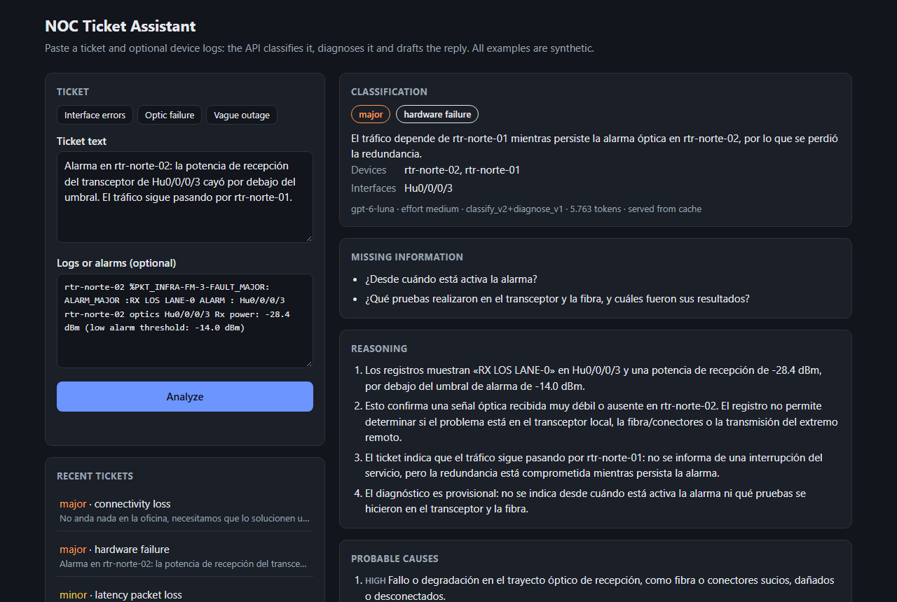
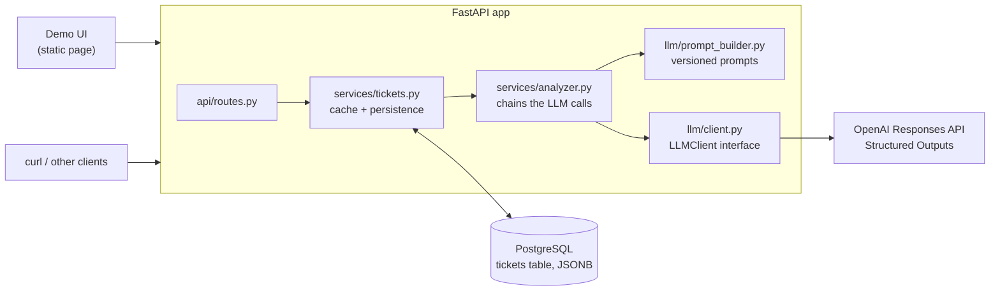
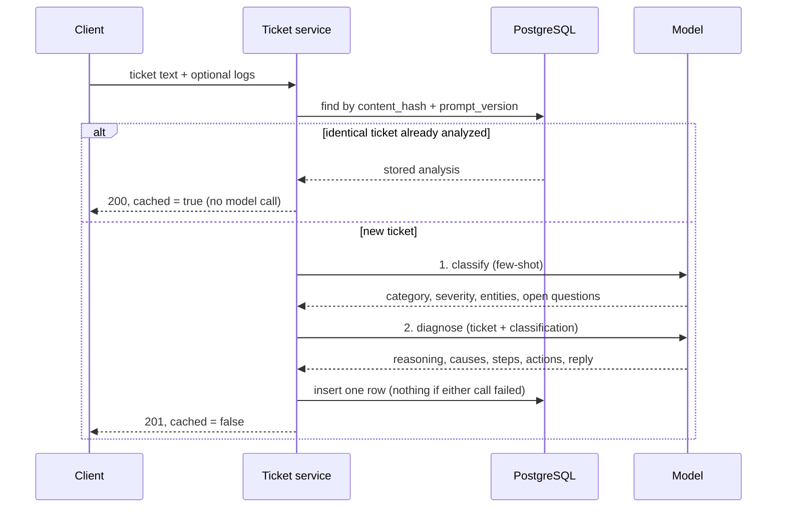

# NOC Ticket Assistant

[](https://github.com/Antonella94duarte/noc-ticket-assistant/actions/workflows/ci.yml)

An API that helps Network Operations Center (NOC) operators triage incident tickets with an LLM.
Given a ticket ("the link to the north site has been down since 3 AM") and optional device logs
or alarms, it returns structured JSON with:

- **Category**: connectivity loss, latency/packet loss, hardware failure, configuration error,
  power alarm or other.
- **Severity**: `critical`, `major`, `minor` or `warning`, with a one-line justification.
- **Entities**: sites, devices, interfaces, IP addresses and event time.
- **Missing information**: what to ask the customer when the ticket isn't enough, instead of
  guessing.
- **Diagnosis**: step-by-step reasoning, probable causes with their evidence, diagnostic steps
  with CLI commands and immediate actions.
- **Customer reply draft**: professional and empathetic, without internal jargon or promises.
  Internal monitoring alarms get no customer reply: their open questions go to the NOC team.



All tickets, logs, sites and devices in this repository are synthetic.

## Quick start

Requires Docker and an OpenAI API key. Where to get the keys for OpenAI and DeepSeek, and how
to set up a free local model with Ollama: [docs/providers-setup.md](docs/providers-setup.md).

```bash
cp .env.example .env          # then set OPENAI_API_KEY
docker compose up --build
```

- Demo UI: http://localhost:8000
- Interactive API docs: http://localhost:8000/docs
- Health check: http://localhost:8000/health

Database migrations run automatically when the API container starts. Without `OPENAI_API_KEY`
the API still starts and the analysis endpoint answers `503`.

## Architecture



The OpenAI SDK is only used inside `llm/client.py`. The rest of the app depends on a small
`LLMClient` interface, so the provider can be swapped and the tests inject a fake client.

### What happens on `POST /api/v1/tickets/analyze`



## How the analysis works

Each ticket goes through two chained model calls (`app/services/analyzer.py`):

1. **Classify** (`classify_v3`): category, severity, entities and the questions still open.
   Few-shot, short output.
2. **Diagnose** (`diagnose_v2`): receives the ticket plus the classification as JSON, decides
   whether a customer or internal monitoring reported it, and returns the reasoning, probable
   causes, diagnostic steps, actions and, for customer tickets, the reply draft.

Splitting the work keeps each prompt focused, lets each step be versioned and tested on its own,
and gives the diagnosis a structured starting point. If either call fails, nothing is stored, so
a half analysis is never served from the cache.

With `gpt-6-luna` at `medium` reasoning effort, an analysis of the sample tickets takes about
13-18 s and 5,000-6,500 tokens including hidden reasoning, about US$0.0015. A repeated ticket is
answered from the database in ~20 ms.

## Prompt engineering

Prompts live in `app/llm/prompts/<version>/` as plain files, separate from the code. Every
analysis stores the `prompt_version` that produced it, and older versions are kept so stored
analyses stay traceable.

| Technique | Where it is used |
|---|---|
| Role, tone and context | System prompts set a senior NOC engineer role and describe a small fictional network used to judge impact |
| Delimiters | The ticket and logs go inside `<ticket>` and `<logs>` tags and are declared as data. Tags written inside them are neutralized so text can't break out of its block. The classification passed to the second call gets the same treatment |
| Few-shot | Five classification examples sent as user/assistant turns, validated against the schema at load time. One contains a prompt-injection attempt that the expected answer ignores; another teaches that lost redundancy is `major` |
| Conditional output | When data is missing, the classification lists questions instead of guessing, and the diagnosis marks itself as provisional. Vague tickets are classified by the symptom they actually state. Internal alarms get no customer reply, and their questions are addressed to the NOC team |
| Chain of thought | `reasoning` is the first field of the diagnosis schema: the model writes JSON in schema order, so it lays out the evidence before concluding, and the operator can audit it |
| Structured output | OpenAI Structured Outputs enforce the Pydantic schemas, and replies are validated again on our side. Refusals and truncated replies become a `502` instead of bad data |
| Chained calls | Classify first, then diagnose using the classification |

## API

| Method | Path | Description |
|---|---|---|
| `POST` | `/api/v1/tickets/analyze` | Analyze a ticket (text + optional logs). `201` when new, `200` with `"cached": true` when an identical ticket was already analyzed |
| `GET` | `/api/v1/tickets/{id}` | A ticket with its stored classification and diagnosis |
| `GET` | `/api/v1/tickets` | Newest first, filters `category` and `severity`, pagination `limit` (max 100) and `offset` |
| `GET` | `/health` | API and database status (`503` when the database is down) |

```bash
curl -X POST http://localhost:8000/api/v1/tickets/analyze \
  -H "Content-Type: application/json" \
  --data-binary @data/samples/interface_errors.json
```

<details>
<summary>Example response (abridged)</summary>

```json
{
  "id": "3d490895-…",
  "created_at": "2026-10-21T23:13:20Z",
  "ticket_text": "Cliente de SITE-ESTE-04 reporta cortes intermitentes…",
  "logs": "sw-este-04 Gi1/0/12 is up, line protocol is up…",
  "cached": false,
  "classification": {
    "category": "latency_packet_loss",
    "severity": "minor",
    "severity_reason": "El servicio presenta cortes intermitentes…",
    "entities": {
      "sites": ["SITE-ESTE-04"],
      "devices": ["sw-este-04"],
      "interfaces": ["Gi1/0/12"],
      "ip_addresses": [],
      "event_time": "09:15 de hoy"
    },
    "missing_information": ["¿Cuál es el circuito o servicio afectado?", "…"]
  },
  "diagnosis": {
    "reasoning": ["El contador muestra 1873 errores de entrada, incluidos 1650 CRC…", "…"],
    "probable_causes": [
      {"cause": "Problema físico en el enlace de Gi1/0/12…", "likelihood": "medium", "evidence": "…"}
    ],
    "diagnostic_steps": [
      {"action": "…", "command": "show interfaces Gi1/0/12", "expected_result": "…"}
    ],
    "recommended_actions": ["…"],
    "customer_reply": "Lamentamos los inconvenientes que están teniendo con las videollamadas…"
  },
  "model": "gpt-6-luna",
  "reasoning_effort": "medium",
  "prompt_version": "classify_v3+diagnose_v2",
  "usage": {"input_tokens": 3785, "output_tokens": 1804, "reasoning_tokens": 273, "total_tokens": 5589}
}
```

</details>

The full analysis in the demo UI: [docs/screenshots/analysis.png](docs/screenshots/analysis.png).

## Data model

One `tickets` table keeps the ticket, its analysis and how it was produced, designed to need few
queries:

- The full analysis is a **JSONB** column, so reading a ticket with its analysis is one query,
  with no joins.
- `category` and `severity` are plain columns with composite indexes on `created_at`, because the
  listing filters by them and sorts by date.
- `content_hash` is a SHA-256 of the ticket text and logs, ignoring line endings and edge
  whitespace. It is unique together with `prompt_version`: an identical ticket is served from the
  database without calling the model, and a new prompt version gets a fresh analysis. Two
  identical requests racing each other end up with one row.
- The listing selects only summary columns (the text is cut to 120 characters in SQL) and gets
  the total from a window function in the same query.
- `prompt_version`, `model`, `reasoning_effort` and token counts are stored with every analysis,
  to know what produced it and what it cost.

## Security and privacy

- **Prompt injection**: customer and device text is delimited and its tags neutralized; the
  prompts state that it is data, never instructions; a few-shot example and an eval case cover
  injection attempts.
- **Untrusted output in the UI**: ticket text and model output are only inserted with
  `textContent`, never as HTML.
- **Provider data**: requests are sent with `store=False`, and provider error details are logged,
  not returned to clients.
- **Secrets**: the API key is a `SecretStr` read from the environment; `.env` is git-ignored.
- **Data**: every example in the repository is synthetic.

## Testing and CI

```bash
pytest
ruff check . && ruff format --check .
```

- Tests never call OpenAI: the LLM client is a FastAPI dependency that tests replace with a fake,
  so they are free, fast and deterministic.
- Database tests run against a real PostgreSQL in a separate `noc_tickets_test` database,
  created and migrated with Alembic, with each test rolled back. Set `TEST_DATABASE_URL` to point
  elsewhere. If PostgreSQL isn't reachable those tests are skipped locally, but they fail in CI so
  a broken setup can't produce a green build.
- GitHub Actions (`.github/workflows/ci.yml`) runs `ruff` and `pytest` against a PostgreSQL 16
  service container on every push and pull request.

## Evaluating prompts

`data/eval/classification.jsonl` holds 23 labeled synthetic tickets, separate from the few-shot
examples. They include vague tickets with and without an outage, internal alarms with lost
redundancy, prompt injections in the ticket and in the logs, an English ticket and the three
samples that motivated earlier prompt fixes. When a case has more than one defensible answer
under the rubric, its label lists all of them; whether a customer reply is expected is labeled
only where it is clear.

`scripts/evaluate.py` runs the pipeline over them with the real model and reports accuracy,
whether a customer reply was drafted when it should be, and the length of the diagnosis. It
spends tokens, so it runs by hand, not in CI:

```bash
python scripts/evaluate.py                                    # classification only
python scripts/evaluate.py --with-diagnosis --runs 2          # both calls, two runs
python scripts/evaluate.py --prompt-version classify_v2 --effort low
```

Results with `gpt-6-luna`, two runs of the 23 cases (46 analyses per row):

| Prompts | Effort | Category | Severity | Customer reply ok | Diagnosis length (visible tokens) |
|---|---|---|---|---|---|
| classify_v2 + diagnose_v1 | medium | 46/46 | 46/46 | 28/42 | mean 1,018, max 1,320 |
| classify_v3 + diagnose_v2 | medium | 46/46 | 45/46 | **41/42** | **mean 840, max 1,068** |
| classify_v2 | low | 44/46 | 44/46 | | |
| classify_v3 | low | **46/46** | **46/46** | | |

How the current prompts got here:

- **Internal alarms**: `diagnose_v1` drafted a customer reply for every monitoring alarm. A first
  `diagnose_v2` that only described internal alarms in general still drafted replies for the four
  that didn't name their source (34/42); defining a customer ticket as one a customer actually
  reports took it to 41/42.
- **Shorter diagnoses**: explicit limits on items and sentences cut the visible output by 17%.
  Measuring this needed care: `output_tokens` includes hidden reasoning tokens, which at first
  hid the change.
- **Vague tickets**: at `low` effort, `classify_v2` turned "Tenemos problemas con el servicio"
  into a major outage, over-applying its rule for "no anda nada". `classify_v3` only treats a
  ticket as an outage when it says the service is down. The first version of that fix then
  rated a failed redundant power supply as `warning` at `low`; naming power supplies and
  rectifiers in the redundancy rule fixed it.
- **Remaining misses** (one run out of two each): the redundant power supply rated `warning`, and
  no reply drafted for "un cliente no puede entrar por SSH", a ticket about a customer written in
  the third person.

## Configuration

| Variable | Default | Description |
|---|---|---|
| `OPENAI_API_KEY` | (unset) | Required for analysis; the endpoint answers `503` without it |
| `OPENAI_MODEL` | (unset) | Any model with Structured Outputs; `.env.example` uses `gpt-6-luna` |
| `OPENAI_REASONING_EFFORT` | `medium` | `low` skipped reasoning and misjudged severity on the samples |
| `OPENAI_TIMEOUT_SECONDS` | `60` | Per request; each analysis makes two requests |
| `DATABASE_URL` | `localhost:5433` | Overridden inside Docker Compose to reach the `db` service |
| `POSTGRES_HOST_PORT` | `5433` | Host port for the database, to avoid clashing with a local PostgreSQL |

## Local development

```bash
python -m venv .venv
source .venv/bin/activate        # Windows: .venv\Scripts\activate
pip install -r requirements-dev.txt
docker compose up -d db          # published on host port 5433
alembic upgrade head
uvicorn app.main:app --reload
```

## Project structure

```
app/
├── main.py              # app factory, error handlers, demo page
├── config.py            # settings from environment variables
├── schemas.py           # Pydantic models: API and LLM output schemas
├── evaluation.py        # scoring for the prompt eval set
├── api/routes.py        # endpoints
├── db/                  # SQLAlchemy model, session, repository
├── llm/
│   ├── client.py        # LLMClient interface and OpenAI implementation
│   ├── prompt_builder.py
│   └── prompts/         # classify_v1..v3, diagnose_v1..v2 (old versions kept)
├── services/            # analyzer (chained calls), tickets (cache + persistence)
└── static/index.html    # demo UI
alembic/                 # migrations
data/samples/            # synthetic tickets for manual testing
data/eval/               # 23 labeled synthetic tickets for prompt evaluation
scripts/evaluate.py      # runs the eval set against the real model
tests/
```

## Next: NOC Agents (in progress)

The project is evolving into a multi-agent system that investigates before diagnosing: instead
of reading only the ticket, agents query the network and the procedures a NOC engineer would use.
The chained pipeline above stays as the baseline to compare against.
See [ADR 0001](docs/decisions/0001-evolve-into-agents.md).

Done so far:

- **Network data**: sites, devices (with redundancy pairs), links, customer circuits and alarms
  in PostgreSQL (`app/db/models.py`, migration in `alembic/`). A synthetic snapshot in
  `data/network/seed.json` is loaded with `python -m app.db.seed` (and on container start). It
  contains several incidents to investigate plus noise and cleared alarms.
- **Tools** (`app/tools/network.py`): `get_active_alarms`, `get_device`, `get_site` and
  `find_circuits`. Plain functions, independent of any agent framework, with compact results,
  capped lists that report truncation, and suggestions when a name is wrong. Active-alarm
  lookups use partial indexes.
- **Runbooks** (`data/runbooks/`): nine synthetic procedures (link down, optical power, CRC
  errors, bundle members, power, PSU/rectifier, configuration rollback, customer without service,
  congestion) for retrieval in a later phase.
- **Provider-agnostic models** (`app/llm/providers.py`): OpenAI, DeepSeek or a local model
  through Ollama, chosen with `LLM_PROVIDER`, with `LLM_FALLBACK_PROVIDERS` tried in order when
  the primary fails. The network tools are exposed as LangChain tools
  (`app/tools/langchain_tools.py`). See [ADR 0002](docs/decisions/0002-provider-agnostic-llm-layer.md).
  `python scripts/check_providers.py` checks each provider's tool calling and structured output
  with real calls.

- **LangGraph agent** (`app/agents/graph.py`): triage -> investigate -> report. The investigator
  is a tool-calling agent that looks up circuits, alarms and topology before anything is
  diagnosed, with LangChain middleware limiting its tool and model calls and falling back to other
  providers. Each run reports the tool calls and their results, tokens per model and latency. See
  [ADR 0003](docs/decisions/0003-langgraph-investigation-agent.md) for the design and the first
  runs on OpenAI, DeepSeek and Ollama.

  ```bash
  python scripts/run_agent.py --scenario customer-no-service   # or slow-site, config-change, ...
  ```

- **Runbook retrieval** (`app/rag/runbooks.py`): the runbooks are indexed by section with
  LlamaIndex and exposed to the investigator as a `search_runbooks` tool, so the diagnosis follows
  the team's procedures and cites them ("[RB-007]"). BM25 by default (offline, free); OpenAI or
  local Ollama embeddings for multilingual search. On 18 labeled queries BM25 gets 12/12 in
  English and 3/6 in Spanish; OpenAI embeddings and the local `bge-m3` both get 18/18. See
  [ADR 0004](docs/decisions/0004-runbook-retrieval.md).

  ```bash
  python scripts/evaluate_retrieval.py bm25 openai ollama
  python scripts/run_agent.py --scenario config-change              # with runbooks
  python scripts/run_agent.py --scenario config-change --no-runbooks
  ```

Next: an evaluation of the agent against the baseline (with and without runbooks, across models)
and a CrewAI comparison.

## Limitations and next steps

- **Run-to-run variation**: two cases still fail in one run out of two (see above); more runs
  and cases would give tighter numbers.
- **Diagnosis quality**: the eval checks the reply decision and the length of the diagnosis, not
  whether its causes and steps are right. That would need expert labels or an LLM-as-judge.
- **Who reported the ticket** is inferred from the text; a real integration would take it from
  the ticketing system.
- **Latency**: the two calls run sequentially and take 13-18 s; streaming or running the
  diagnosis in the background would improve the experience.
- **Network context**: the network catalog is hardcoded in the prompts; a real deployment would
  read it from an inventory system.
