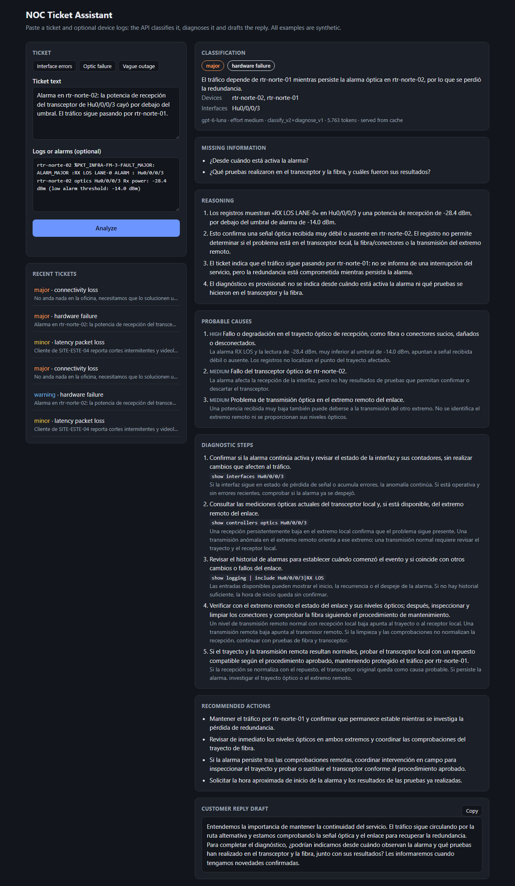
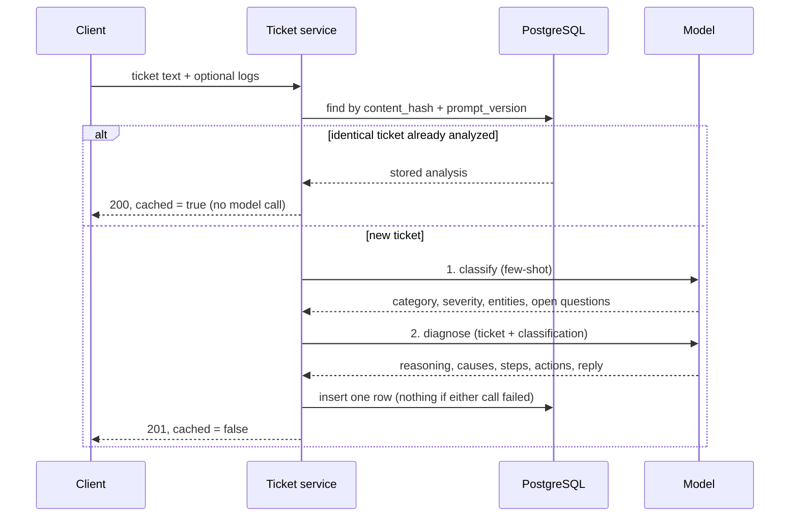

# Baseline pipeline: two chained LLM calls

The first version of the project, kept as the baseline the agent is measured against
([model-comparison.md](model-comparison.md)). It reads only the ticket and its logs: no network
data, no runbooks. It is still served by the API (`POST /api/v1/tickets/analyze`) and by the
**Pipeline** mode of the demo page, and it is where the prompt-engineering work started.

Given a ticket and optional logs it returns the category, severity with a justification, the
entities (sites, devices, interfaces, IPs, time), the questions still open, a diagnosis with
probable causes, diagnostic steps with CLI commands, and a customer reply draft (none for internal
monitoring alarms). Analyses are stored in PostgreSQL and an identical ticket is served from the
database without calling the model.



## What happens on `POST /api/v1/tickets/analyze`



## How the analysis works

Each ticket goes through two chained model calls (`app/services/analyzer.py`):

1. **Classify** (`classify_v3`): category, severity, entities and the questions still open.
   Few-shot, short output.
2. **Diagnose** (`diagnose_v2`): receives the ticket plus the classification as JSON, decides
   whether a customer or internal monitoring reported it, and returns the reasoning, probable
   causes, diagnostic steps, actions and, for customer tickets, the reply draft.

Splitting the work keeps each prompt focused, lets each step be versioned and tested on its own,
and gives the diagnosis a structured starting point. If either call fails, nothing is stored, so
a half analysis is never served from the cache.

With `gpt-6-luna` at `medium` reasoning effort, an analysis of the sample tickets takes about
13-18 s and 5,000-6,500 tokens including hidden reasoning, about US$0.0015. A repeated ticket is
answered from the database in ~20 ms.

## Prompt engineering

Prompts live in `app/llm/prompts/<version>/` as plain files, separate from the code. Every
analysis stores the `prompt_version` that produced it, and older versions are kept so stored
analyses stay traceable.

| Technique | Where it is used |
|---|---|
| Role, tone and context | System prompts set a senior NOC engineer role and describe a small fictional network used to judge impact |
| Delimiters | The ticket and logs go inside `<ticket>` and `<logs>` tags and are declared as data. Tags written inside them are neutralized so text can't break out of its block. The classification passed to the second call gets the same treatment |
| Few-shot | Five classification examples sent as user/assistant turns, validated against the schema at load time. One contains a prompt-injection attempt that the expected answer ignores; another teaches that lost redundancy is `major` |
| Conditional output | When data is missing, the classification lists questions instead of guessing, and the diagnosis marks itself as provisional. Vague tickets are classified by the symptom they actually state. Internal alarms get no customer reply, and their questions are addressed to the NOC team |
| Chain of thought | `reasoning` is the first field of the diagnosis schema: the model writes JSON in schema order, so it lays out the evidence before concluding, and the operator can audit it |
| Structured output | OpenAI Structured Outputs enforce the Pydantic schemas, and replies are validated again on our side. Refusals and truncated replies become a `502` instead of bad data |
| Chained calls | Classify first, then diagnose using the classification |

## API

| Method | Path | Description |
|---|---|---|
| `POST` | `/api/v1/tickets/analyze` | Analyze a ticket (text + optional logs). `201` when new, `200` with `"cached": true` when an identical ticket was already analyzed |
| `GET` | `/api/v1/tickets/{id}` | A ticket with its stored classification and diagnosis |
| `GET` | `/api/v1/tickets` | Newest first, filters `category` and `severity`, pagination `limit` (max 100) and `offset` |
| `GET` | `/health` | API and database status (`503` when the database is down) |

```bash
curl -X POST http://localhost:8000/api/v1/tickets/analyze \
  -H "Content-Type: application/json" \
  --data-binary @data/samples/interface_errors.json
```

<details>
<summary>Example response (abridged)</summary>

```json
{
  "id": "3d490895-…",
  "created_at": "2026-10-21T23:13:20Z",
  "ticket_text": "Cliente de SITE-ESTE-04 reporta cortes intermitentes…",
  "logs": "sw-este-04 Gi1/0/12 is up, line protocol is up…",
  "cached": false,
  "classification": {
    "category": "latency_packet_loss",
    "severity": "minor",
    "severity_reason": "El servicio presenta cortes intermitentes…",
    "entities": {
      "sites": ["SITE-ESTE-04"],
      "devices": ["sw-este-04"],
      "interfaces": ["Gi1/0/12"],
      "ip_addresses": [],
      "event_time": "09:15 de hoy"
    },
    "missing_information": ["¿Cuál es el circuito o servicio afectado?", "…"]
  },
  "diagnosis": {
    "reasoning": ["El contador muestra 1873 errores de entrada, incluidos 1650 CRC…", "…"],
    "probable_causes": [
      {"cause": "Problema físico en el enlace de Gi1/0/12…", "likelihood": "medium", "evidence": "…"}
    ],
    "diagnostic_steps": [
      {"action": "…", "command": "show interfaces Gi1/0/12", "expected_result": "…"}
    ],
    "recommended_actions": ["…"],
    "customer_reply": "Lamentamos los inconvenientes que están teniendo con las videollamadas…"
  },
  "model": "gpt-6-luna",
  "reasoning_effort": "medium",
  "prompt_version": "classify_v3+diagnose_v2",
  "usage": {"input_tokens": 3785, "output_tokens": 1804, "reasoning_tokens": 273, "total_tokens": 5589}
}
```

</details>

The full analysis in the demo UI: [screenshots/analysis.png](screenshots/analysis.png).

## Data model

One `tickets` table keeps the ticket, its analysis and how it was produced, designed to need few
queries:

- The full analysis is a **JSONB** column, so reading a ticket with its analysis is one query,
  with no joins.
- `category` and `severity` are plain columns with composite indexes on `created_at`, because the
  listing filters by them and sorts by date.
- `content_hash` is a SHA-256 of the ticket text and logs, ignoring line endings and edge
  whitespace. It is unique together with `prompt_version`: an identical ticket is served from the
  database without calling the model, and a new prompt version gets a fresh analysis. Two
  identical requests racing each other end up with one row.
- The listing selects only summary columns (the text is cut to 120 characters in SQL) and gets
  the total from a window function in the same query.
- `prompt_version`, `model`, `reasoning_effort` and token counts are stored with every analysis,
  to know what produced it and what it cost.

## Evaluating prompts

`data/eval/classification.jsonl` holds 23 labeled synthetic tickets, separate from the few-shot
examples. They include vague tickets with and without an outage, internal alarms with lost
redundancy, prompt injections in the ticket and in the logs, an English ticket and the three
samples that motivated earlier prompt fixes. When a case has more than one defensible answer
under the rubric, its label lists all of them; whether a customer reply is expected is labeled
only where it is clear.

`scripts/evaluate.py` runs the pipeline over them with the real model and reports accuracy,
whether a customer reply was drafted when it should be, and the length of the diagnosis. It
spends tokens, so it runs by hand, not in CI:

```bash
python scripts/evaluate.py                                    # classification only
python scripts/evaluate.py --with-diagnosis --runs 2          # both calls, two runs
python scripts/evaluate.py --prompt-version classify_v2 --effort low
```

Results with `gpt-6-luna`, two runs of the 23 cases (46 analyses per row):

| Prompts | Effort | Category | Severity | Customer reply ok | Diagnosis length (visible tokens) |
|---|---|---|---|---|---|
| classify_v2 + diagnose_v1 | medium | 46/46 | 46/46 | 28/42 | mean 1,018, max 1,320 |
| classify_v3 + diagnose_v2 | medium | 46/46 | 45/46 | **41/42** | **mean 840, max 1,068** |
| classify_v2 | low | 44/46 | 44/46 | | |
| classify_v3 | low | **46/46** | **46/46** | | |

How the current prompts got here:

- **Internal alarms**: `diagnose_v1` drafted a customer reply for every monitoring alarm. A first
  `diagnose_v2` that only described internal alarms in general still drafted replies for the four
  that didn't name their source (34/42); defining a customer ticket as one a customer actually
  reports took it to 41/42.
- **Shorter diagnoses**: explicit limits on items and sentences cut the visible output by 17%.
  Measuring this needed care: `output_tokens` includes hidden reasoning tokens, which at first
  hid the change.
- **Vague tickets**: at `low` effort, `classify_v2` turned "Tenemos problemas con el servicio"
  into a major outage, over-applying its rule for "no anda nada". `classify_v3` only treats a
  ticket as an outage when it says the service is down. The first version of that fix then
  rated a failed redundant power supply as `warning` at `low`; naming power supplies and
  rectifiers in the redundancy rule fixed it.
- **Remaining misses** (one run out of two each): the redundant power supply rated `warning`, and
  no reply drafted for "un cliente no puede entrar por SSH", a ticket about a customer written in
  the third person.
