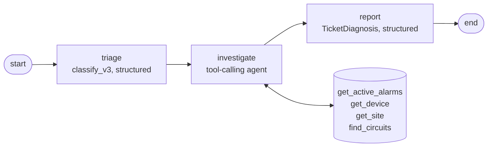

# ADR 0003: A three-step LangGraph graph with one tool-using investigator

- Status: accepted
- Date: 2026-10-24

## Context

The baseline only sees the ticket. To diagnose like a NOC engineer, the system has to look at the
network first: the customer's circuit and access port, the active alarms of a site, the topology
around a failed link. That requires an agent that decides which lookups to make (ADR 0001) on any
of the configured providers (ADR 0002), without looping or spending without bounds.

## Decision

`app/agents/graph.py` builds a LangGraph `StateGraph` with three nodes:

- **triage** reuses `classify_v3` (few-shot, structured output): proven on the eval set, and the
  investigator gets the category, severity and entities as a starting point.
- **investigate** is a LangChain `create_agent` agent with the four network tools and its own
  prompt (`investigate_v1`): start from the entities, follow the evidence through the topology,
  correlate timestamps, stop when the cause is found, and hand over facts, not a diagnosis.
- **report** (`report_v1`) writes the diagnosis and the customer reply from the findings plus the
  raw tool results. It returns the same `TicketDiagnosis` schema as the baseline, so the two can
  be evaluated side by side.

Guard rails, all from LangChain middleware:

- `ToolCallLimitMiddleware` (`AGENT_MAX_TOOL_CALLS`, default 8) with `exit_behavior="continue"`:
  past the limit the agent can't call tools and must conclude with what it has.
- `ModelCallLimitMiddleware` (`AGENT_MAX_MODEL_CALLS`, default 6) with `exit_behavior="end"`: the
  hard stop for an agent stuck in a loop. Its notice is kept in the findings so the report knows
  the investigation was cut short.
- `ModelFallbackMiddleware` with the providers in `LLM_FALLBACK_PROVIDERS`; triage and report use
  `with_fallbacks` over the same models.

Every run returns an `AgentAnalysis` with the tool calls and their results, the number of model
calls (counted with a callback, because the limit middleware adds its own AI message), whether a
limit was reached, tokens per model and latency.

## First runs (`scripts/run_agent.py`, 2026-10-24)

Five scenarios built on the incidents in the synthetic network snapshot, one run each:

| Scenario | Provider | What the investigation found | Tools | Latency | Tokens |
|---|---|---|---|---|---|
| Customer without service (no circuit given) | OpenAI | Circuit SUR-2210 and alarm 11 (no light from the customer side) on its port | 4 | 41 s | ~13.5k |
| Slow site | OpenAI | Uplink Te1/1/1 down, so all traffic on Te1/1/2 at 92%; CRC and ONU alarms set apart | 3 | 42 s | ~14k |
| Slow site | DeepSeek, effort low | Same root cause, and it checked the far end of the failed uplink and a degraded bundle upstream | 6 | 28 s | ~22k |
| Slow site | Ollama `qwen3:4b`, thinking off | Right root cause, but its reasoning leaked into the findings, it blamed the CRC errors on congestion, and the reply restated the ticket | 3 | 154 s | ~25k |
| Configuration change | OpenAI | Customer's colocation port and alarm 15 (VLAN 210 removed from the trunk at 02:10) | 4 | 38 s | ~13.5k |
| Internal power alarm | OpenAI | Site on batteries, 78% left, ~3 h autonomy; no customer reply | 3 | 35 s | ~13k |
| Vague ticket | OpenAI | One network-wide alarm check; no alarm can be tied to the ticket, so it asks for the customer | 1 | 29 s | ~12k |

No run hit the tool or model call limits. Problems found and fixed on the way:

- **DeepSeek** at its default effort (`high`) spent the whole 4,000-token budget reasoning on the
  report and returned nothing. `DEEPSEEK_REASONING_EFFORT` now defaults to `low`.
- **Ollama**'s default 4,096-token context is too small for the few-shot triage prompt (the model
  answered with nothing). `OLLAMA_NUM_CTX` defaults to 16,384, which no longer fits entirely in
  the 6 GB laptop GPU; with thinking on, `qwen3:4b` still returned an empty report.

Open issue for the evaluation: the severity comes from triage and is not revised after the
investigation (the power alarm stayed `warning` although the site has ~3 h of battery left).

## Alternatives considered

- **One agent for everything** (classify, investigate and write the reply in a single loop).
  Fewer moving parts, but the output would not be structured until the very end, the proven
  few-shot triage would be lost, and a single long prompt is harder to evaluate step by step.
- **Several autonomous agents with a supervisor.** Fits open-ended problems; here the steps are
  known in advance, and a supervisor would add model calls and nondeterminism without a clear
  benefit. A fixed graph is cheaper and easier to explain and test.
- **Writing the tool loop by hand.** Possible (it is a short loop), but `create_agent` brings the
  limits and fallback as tested middleware, and it is what the LangChain ecosystem uses.

## Consequences

- An analysis now takes several model calls; the evaluation (next phase) has to show whether the
  investigation improves the diagnosis enough to justify the extra latency and cost.
- The graph depends only on LangChain chat models and tools: tests run it end to end with a
  scripted fake model and the real tools on the test database.
